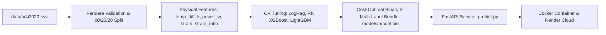

# Predictive Maintenance — Machine Failure & Failure Mode Prediction (AI4I 2020)

[](https://github.com/igmriegel/ML_Zoomcamp_Midterm/actions/workflows/ci.yml)

End-to-end machine learning service for industrial **predictive maintenance** on a milling machine, built for the ML Zoomcamp Midterm Project.

Given real-time sensor readings, the API answers two operational questions:
1. **Will the machine fail?** (`failure`: binary classification with a cost-optimal probability threshold where $\text{Cost}_{\text{FN}} = 10 \times \text{Cost}_{\text{FP}}$).
2. **Which failure mode(s) are likely?** (`likely_modes`: multi-label classification across `TWF`, `HDF`, `PWF`, and `OSF`).

---

## 1. Problem Description & Business Context

Unplanned milling machine downtime causes costly production halts, scrap parts, and potential equipment damage, whereas unnecessary preventive inspections incur a much smaller operational cost. We model this asymmetry explicitly using a **10:1 cost ratio** ($\text{FN} = 10$, $\text{FP} = 1$).

- **Target users:** Plant reliability engineers, maintenance planners, and automated SCADA/IoT alerting pipelines.
- **Primary selection metric:** **PR-AUC** (Average Precision) via 5-fold stratified cross-validation, because machine failures are rare (~3.39% positive rate) and PR-AUC focuses on precision/recall trade-offs on the minority failure class.
- **Operating threshold:** Selected on the validation split to minimize total expected misclassification cost, then evaluated **once** on the held-out test split.

---

## 2. Dataset & EDA Summary

- **Source:** [AI4I 2020 Predictive Maintenance Dataset (UCI ID 601)](https://archive.ics.uci.edu/dataset/601) — 10,000 rows, 14 columns, CC BY 4.0 license, committed in [`data/ai4i2020.csv`](data/ai4i2020.csv) (with [`scripts/download_data.py`](scripts/download_data.py) as fallback).
- **Data integrity:** 0 missing values, 0 duplicate rows, unique `udi` identifiers, validated with a strict `pandera` schema in [`src/pdm/data.py`](src/pdm/data.py).
- **Leakage prevention:** `udi`, `product_id`, and all failure mode indicators (`twf`, `hdf`, `pwf`, `osf`, `rnf`) are excluded from model inputs.
- **Domain-informed derived features** ([`src/pdm/features.py`](src/pdm/features.py)):
  - `temp_diff_k = process_temperature_k - air_temperature_k` (heat dissipation failure signal, `HDF`)
  - `power_w = torque_nm * rotational_speed_rpm * (2 * pi / 60)` (mechanical power in Watts, `PWF`)
  - `strain = tool_wear_min * torque_nm` (overstrain proxy, `OSF`)
  - `strain_ratio = strain / limit(type)` where `L=11000`, `M=12000`, `H=13000` (normalized overstrain ratio)
- **Feature ablation (5-fold CV PR-AUC gain from derived features):**
  - `lightgbm`: `0.7868 -> 0.9036` (`+0.1168`)
  - `random_forest`: `0.7570 -> 0.9014` (`+0.1443`)
  - `xgboost`: `0.7813 -> 0.8858` (`+0.1045`)
  - `logreg`: `0.4721 -> 0.5036` (`+0.0315`)
- **Split:** Stratified 60% train / 20% validation / 20% test (`seed=42`).

Full exploratory charts (histograms/KDE, IQR outlier analysis, 2D physical boundaries, correlation heatmap), mutual information, multi-model ablation, PR/ROC curves, expanded permutation importance, and test error analysis are in [`notebook.ipynb`](notebook.ipynb).

---

## 3. Model Comparison & Results

Four model families were tuned with `RandomizedSearchCV` over 5-fold stratified CV:

| Model | CV PR-AUC | Val PR-AUC | Val ROC-AUC | Fit Time (s) |
|---|---:|---:|---:|---:|
| **LightGBM** *(winner)* | **0.9137** | 0.8708 | 0.9832 | 13.86 |
| Random Forest | 0.9113 | **0.8735** | 0.9811 | 72.60 |
| XGBoost (`xgboost-cpu`) | 0.9034 | 0.8525 | **0.9835** | 9.85 |
| Logistic Regression *(baseline)* | 0.5118 | 0.4633 | 0.9089 | 2.48 |

### Held-Out Test Set Performance

- **Binary (`machine_failure`, `lightgbm` @ `threshold = 0.06`):**
  - **PR-AUC:** `0.9047` (vs. Logistic Regression baseline `0.4455`)
  - **ROC-AUC:** `0.9758`
  - **Recall:** `0.8824` | **Precision:** `0.5556` | **F1:** `0.6818`
  - **Expected Cost (FN=10, FP=1):** `128.0`
- **Multi-Label Failure Modes (`MultiOutputClassifier(lightgbm, class_weight="balanced")` with validation-calibrated thresholds):**
  - **Macro PR-AUC:** `0.7552` (vs. mean prevalence `0.0085`) | **Macro Recall:** `0.9250` | **Macro F1:** `0.7498`
  - `hdf`: PR-AUC `1.0000`, Recall `1.0000`, F1 `1.0000` (`thr = 0.50`)
  - `pwf`: PR-AUC `0.9725`, Recall `1.0000`, F1 `0.9630` (`thr = 0.50`)
  - `osf`: PR-AUC `0.9792`, Recall `1.0000`, F1 `0.9412` (`thr = 0.50`)
  - `twf`: PR-AUC `0.0691`, Recall `0.7000`, F1 `0.0952` (`thr = 0.05`)

---

## 4. Architecture & Project Structure



```text
├── data/                   # Committed AI4I 2020 CSV + data dictionary
├── models/                 # Trained bundle (model.bin) & metrics.json
├── notebook.ipynb          # Reproducible EDA, tuning & evaluation notebook
├── predict.py              # FastAPI service (/health, /predict, /predict/batch)
├── predict_test.py         # Smoke client (nominal vs. high-risk readings)
├── scripts/
│   ├── check_metrics.py    # Automated quality gate
│   └── download_data.py    # UCI fallback downloader
├── src/pdm/                # Core package (config, data, features, pipeline, evaluate, model_io, training, schemas)
├── tests/                  # Unit, API, and integration tests (>= 90% coverage)
├── train.py                # CLI training entrypoint
├── Dockerfile              # Multi-stage non-root image (< 600 MB)
├── render.yaml             # Render Blueprint configuration
└── Makefile                # Common automation targets
```

---

## 5. Setup & Installation (`uv` or `pip` + Virtual Environment)

Install [`uv`](https://docs.astral.sh/uv/getting-started/installation/) if not already installed, sync the locked environment, and activate `.venv`:

### Linux / macOS (`uv`)
```bash
curl -LsSf https://astral.sh/uv/install.sh | sh
uv sync --frozen
source .venv/bin/activate
```

### Windows (PowerShell, `uv`)
```powershell
powershell -ExecutionPolicy ByPass -c "irm https://astral.sh/uv/install.ps1 | iex"
uv sync --frozen
.venv\Scripts\Activate.ps1
```

### Alternative (`pip` + standard `venv`, Python >= 3.11)
```bash
python -m venv .venv
source .venv/bin/activate  # Windows: .venv\Scripts\activate
pip install -r requirements.txt
```

---

## 6. Training & Quality Gate

```bash
uv run python train.py
uv run python scripts/check_metrics.py
```

Or via `Makefile`:
```bash
make train
make gate
```

---

## 7. Running the API Service Locally

Start the FastAPI server (Swagger UI available at `http://localhost:9696/docs`):
```bash
uv run uvicorn predict:app --host 0.0.0.0 --port 9696
```

Test with the smoke script:
```bash
uv run python predict_test.py --url http://localhost:9696
```

Or with `curl`:
```bash
curl -s http://localhost:9696/health

curl -s -X POST http://localhost:9696/predict \
  -H "Content-Type: application/json" \
  -d '{
    "type": "L",
    "air_temperature_k": 302.5,
    "process_temperature_k": 310.2,
    "rotational_speed_rpm": 1350,
    "torque_nm": 65.0,
    "tool_wear_min": 215
  }'
```

---

## 8. Containerization (Docker)

Build and run the multi-stage non-root container:
```bash
docker build -t pdm-service .
docker run --rm -p 9696:9696 -e PORT=9696 pdm-service
```

Run the full container smoke test:
```bash
make docker-smoke
```

---

## 9. Cloud Deployment (Render)

This repository includes [`render.yaml`](render.yaml) for one-click deployment on [Render](https://render.com) (`New -> Blueprint -> Select repository`).

- **Live URL:** https://pdm-ai4i2020.onrender.com
- **Health check:** [`GET /health`](https://pdm-ai4i2020.onrender.com/health)
- **Docs (Swagger UI):** [`GET /docs`](https://pdm-ai4i2020.onrender.com/docs)

Verified against the live deployment:
```bash
uv run python predict_test.py --url https://pdm-ai4i2020.onrender.com
```

Example live response (`GET /health` -> HTTP `200`):
```json
{"status": "ok", "model_version": "0.1.0", "algorithm": "lightgbm"}
```

> **Teardown:** To avoid any cloud charges or idle resources, suspend or delete the `pdm-ai4i2020` web service from the Render Dashboard (`Settings -> Suspend Web Service` or `Delete Web Service`).

---

## 10. Quality & Testing Harness

```bash
uv run ruff check .
uv run ruff format --check .
uv run mypy
uv run pytest --cov=src --cov=predict --cov-report=term-missing
```

CI (`.github/workflows/ci.yml`) runs linting, type-checking, `pytest` (>= 90% coverage), fast training + quality gate, `papermill` notebook execution, Docker image size check (< 600 MB), and container smoke tests on every push and pull request.

---

## 11. Limitations & Future Work

- **TWF (Tool Wear Failure) precision-recall trade-off:** With only 0.50% prevalence in the test set and stochastic tool-wear thresholds in the AI4I 2020 synthetic generator, calibrating the `twf` threshold (`0.05`) with `class_weight="balanced"` recovers `0.7000` recall (up from `0.0000`), at the cost of lower per-mode precision (`0.0511`), which is mitigated at inference time because `likely_modes` is only surfaced when the binary model predicts `failure = true`.
- **Synthetic dataset:** AI4I 2020 is a synthetic benchmark; real-world deployment requires calibration on actual plant telemetry and drift monitoring.
